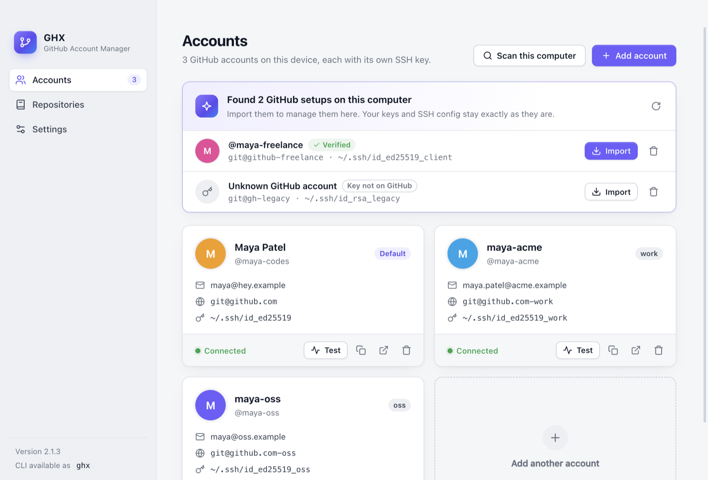
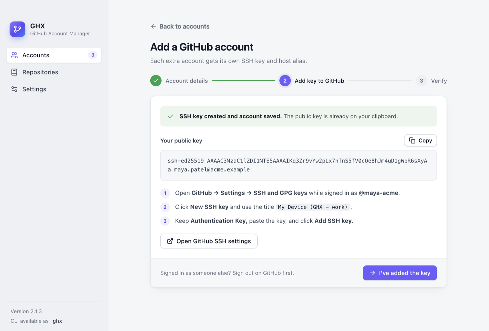
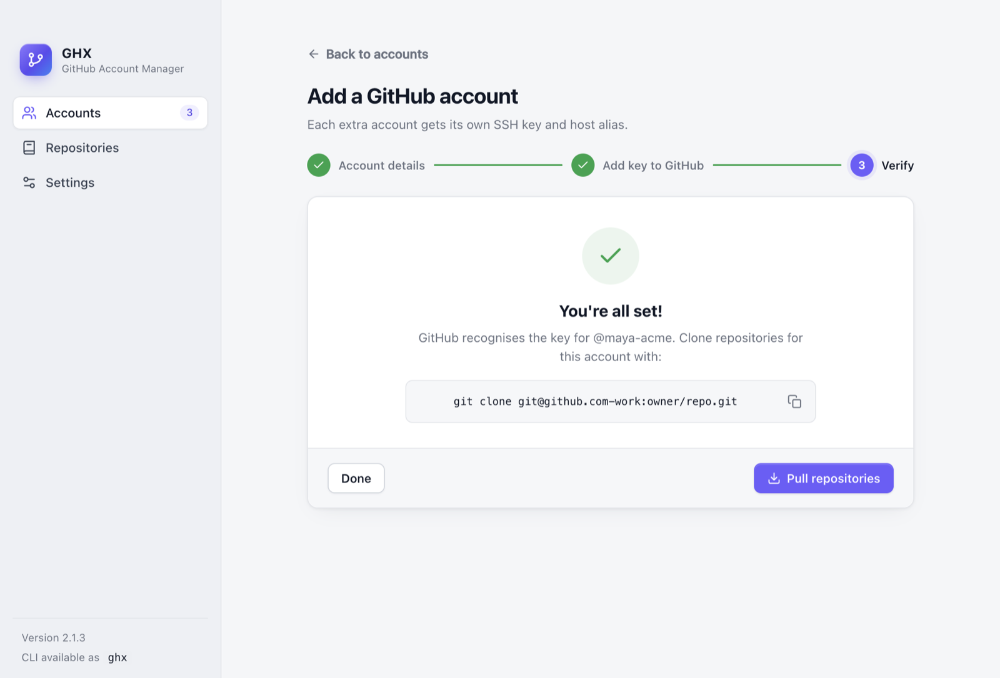
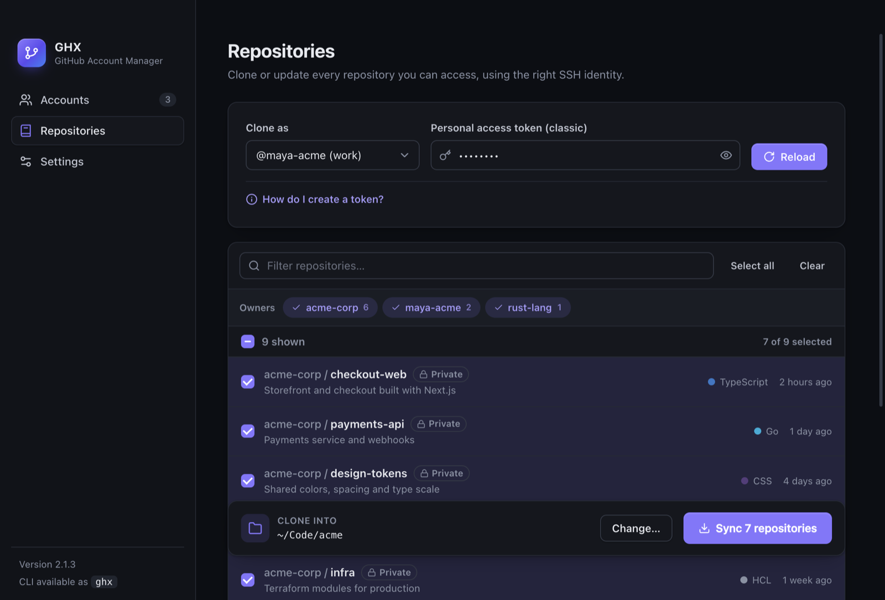
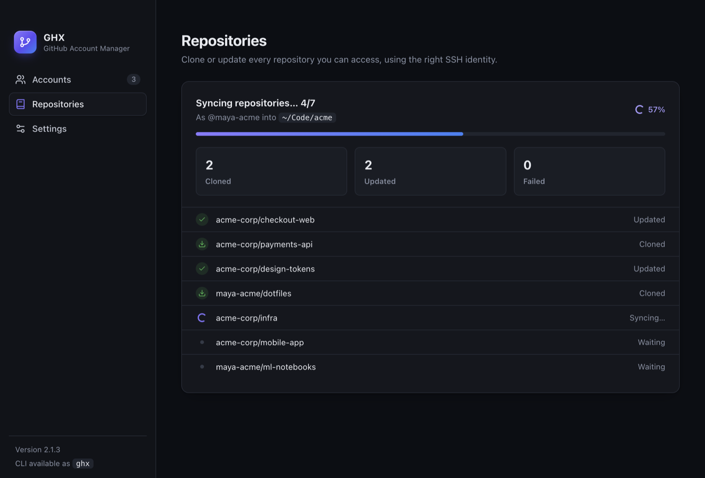

# 🚀 GHX – GitHub Account Manager

> **Manage multiple GitHub accounts, SSH keys, and repositories effortlessly.**

<p align="center">
  
</p>

**GHX** is a desktop app and CLI designed to solve the pain of switching between Work, Personal, and Client GitHub accounts. It handles SSH keys, Git configs, and repo syncing automatically—so you never commit with the wrong email again.

---

## ✨ Features

- **🔑 Multi-Account Management**: Seamlessly switch between accounts. Each gets a dedicated, isolated SSH key.
- **🛡️ Security First**:
  - Supports **SSH Passphrases**.
  - **Connection Checks**: Verifies internet before generating keys.
  - **Safe Conflict Handling**: Never blindly overwrites existing keys.
- **⚡ Smart Repository Sync**:
  - **Fetch ALL Repos**: Pagination support to find _every_ repo you have access to.
  - **Zero Conflicts**: Automatically renames folders (`repo+username`) if naming collisions occur.
  - **Full Git Sync**: Runs `remote set-url`, `fetch tags`, and `pull` in one go.
- **🤖 Automation**:
  - **Auto-Config**: Sets `user.name` and `user.email` locally for every cloned repo.
  - **Host Verification**: Auto-accepts valid GitHub host keys to prevent prompts.
- **✅ Verification Tools**:
  - **Validate Connections**: Test your SSH access instantly from the menu.
  - **Self-Healing**: Tools to clean up invalid keys and configs.

---

## 🖥️ Desktop App

GHX is also a desktop app for Windows, macOS and Linux. It shares the same accounts and config as the CLI.

| Platform | Download |
| --- | --- |
| macOS (Apple Silicon) | [GHX-mac-arm64.dmg](https://github.com/purshottam-jain24/ghx/releases/latest/download/GHX-mac-arm64.dmg) |
| macOS (Intel) | [GHX-mac-x64.dmg](https://github.com/purshottam-jain24/ghx/releases/latest/download/GHX-mac-x64.dmg) |
| Windows | [GHX-Setup-x64.exe](https://github.com/purshottam-jain24/ghx/releases/latest/download/GHX-Setup-x64.exe) |
| Linux (AppImage) | [GHX-linux-x86_64.AppImage](https://github.com/purshottam-jain24/ghx/releases/latest/download/GHX-linux-x86_64.AppImage) |
| Linux (Debian/Ubuntu) | [GHX-linux-amd64.deb](https://github.com/purshottam-jain24/ghx/releases/latest/download/GHX-linux-amd64.deb) |

<table>
  <tr>
    <td width="50%"></td>
    <td width="50%"></td>
  </tr>
  <tr>
    <td align="center"><sub>Guided setup: the key is created and copied for you</sub></td>
    <td align="center"><sub>Connection verified, ready to clone</sub></td>
  </tr>
  <tr>
    <td width="50%"></td>
    <td width="50%"></td>
  </tr>
  <tr>
    <td align="center"><sub>Pick repositories by owner, in light or dark mode</sub></td>
    <td align="center"><sub>Live clone and update progress</sub></td>
  </tr>
</table>

What it does:

- **Detects existing setups**: finds GitHub keys and `~/.ssh/config` hosts already on your computer and imports them in one click.
- **Guided account setup**: creates the key, copies it for you, opens GitHub, and verifies the connection.
- **Delete any account**: removes GHX accounts or unmanaged setups, optionally with their key files.
- **Repository sync**: searchable repo list with owner filters and live clone/update progress.

**First launch on macOS:** open the `.dmg`, drag **GHX** into **Applications**, and open it. If macOS says it can't verify the developer:

- **macOS 15 and later:** open **System Settings › Privacy & Security**, scroll down and click **Open Anyway**.
- **macOS 14 and earlier:** right-click GHX in Applications and choose **Open**.

You only need to do this once. On Windows, choose **More info › Run anyway** if SmartScreen appears.

Every release includes `SHA256SUMS.txt`. To verify a download: `shasum -a 256 -c SHA256SUMS.txt --ignore-missing`.

### Code signing (maintainers)

The release workflow signs the apps automatically when these repository secrets exist:

| Secret | Purpose |
| --- | --- |
| `MAC_CSC_LINK` | Base64 of your **Developer ID Application** `.p12` |
| `MAC_CSC_KEY_PASSWORD` | Password of that `.p12` |
| `MAC_CSC_NAME` | Certificate name, e.g. `Your Name (TEAMID)` |
| `APPLE_ID`, `APPLE_APP_SPECIFIC_PASSWORD`, `APPLE_TEAM_ID` | Notarization with Apple |
| `WIN_CSC_LINK`, `WIN_CSC_KEY_PASSWORD` | Windows code-signing certificate (`.pfx`, base64) and password |

Without them, macOS builds are ad-hoc signed and Windows builds are unsigned.

Run it from source with `npm install && npm run desktop`.

---

## 📦 CLI Installation

### Windows (PowerShell)

```powershell
irm https://github.com/purshottam-jain24/ghx/releases/latest/download/install.ps1 | iex
```

### macOS / Linux

```bash
curl -fsSL https://github.com/purshottam-jain24/ghx/releases/latest/download/install.sh | bash
```

### Install from Source

```bash
git clone https://github.com/purshottam-jain24/ghx.git
cd ghx
npm install
npm link
```

---

## 🚀 Usage

Simply run `ghx` to start:

```bash
ghx
```

### 📋 Menu Options

1.  **Setup GitHub (first time)**
    - Configures your **primary** account and global identity.

2.  **Add another GitHub account**
    - Adds secondary accounts (e.g., Work). Isolate keys and aliases automatically.

3.  **List all accounts**
    - View all configured accounts and their SSH aliases.

4.  **Verify an account connection**
    - Test SSH connectivity to GitHub for any account.

5.  **Remove an account**
    - Safely delete an account, its keys, and config entries.

6.  **Pull repositories**
    - The ultimate sync tool. Fetches **everything** (owned, collaborated, orgs).
    - Handles naming conflicts and ensures Git is up to date.

---

## ⚙️ Technical Details

- **Config**: `~/.ghx/config.json`
- **SSH Keys**: `~/.ssh/` (Ed25519)
- **SSH Config**: `~/.ssh/config` (Additive updates only)

---

## 🤝 Contributing

Contributions are welcome! Please feel free to submit a Pull Request.

## 📄 License

ISC © **Purshottam Jain**
